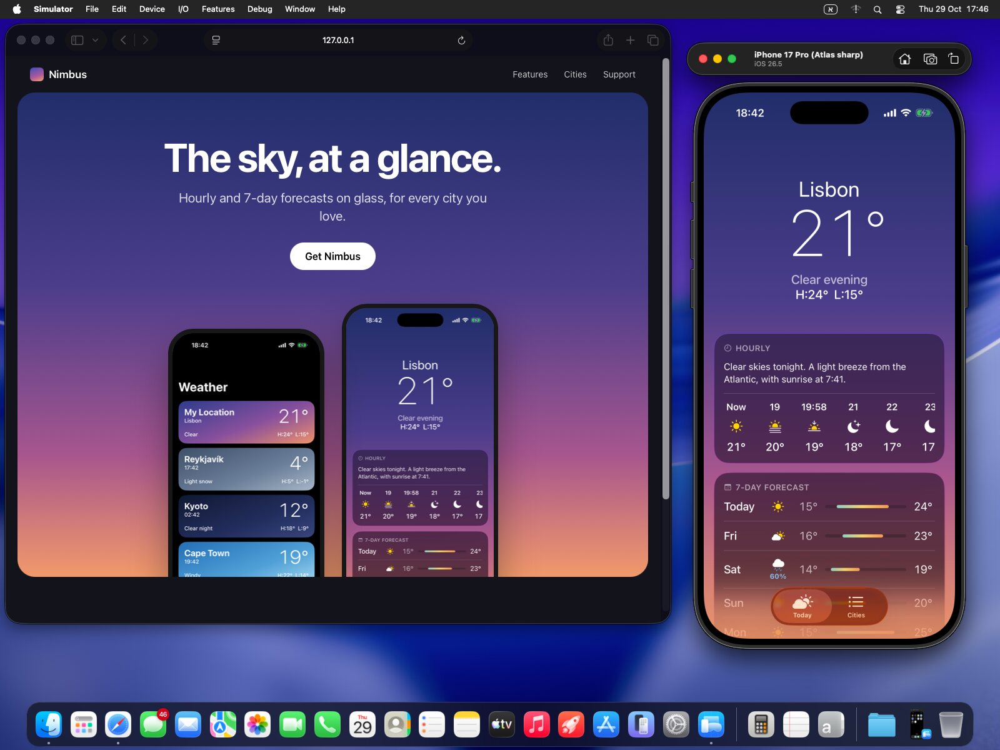
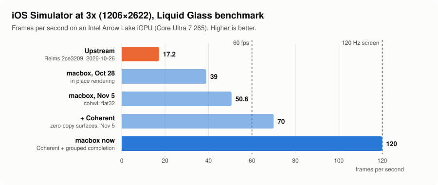

# macbox

macbox gives your AI coding agents a Mac on Linux. It runs a full macOS VM in Docker that draws
with Metal on your own GPU, so Xcode and the real iOS Simulator run on the machine you already
have, with no Mac and no cloud service. Claude Code, Codex and T3 Code each get their own iPhone
simulator to build an app, run it, tap through it, take screenshots and record video, on their own.

It's fast: an iPhone 17 Pro simulator at full 3x resolution renders a heavy Liquid Glass screen at
**120 fps on an Intel integrated GPU**, the screen's full refresh rate. Before macbox's patches, the same GPU managed 17.

**Website:** [tuna-nope.github.io/macbox](https://tuna-nope.github.io/macbox/)



<sub>macOS 26 Tahoe in macbox on an Intel iGPU, captured as it is: an iPhone 17 Pro simulator
running Nimbus, a weather app, beside its website in Safari.</sub>

## What it does

- **macOS draws on your GPU.** [Reims vGPU](https://github.com/steelbrain/reims-vgpu) gives QEMU
  Apple's paravirtual GPU, so macOS's own driver works with no guest driver, and
  [metal2vulkan](https://github.com/steelbrain/metal2vulkan) runs Metal's work on Vulkan. macbox
  builds both with its own patches, which removed the copies between guest memory and the GPU.
- **iOS Simulators for agents.** `mac-sim` gives each checkout its own simulator from a pool. It
  builds the app on the Mac, runs Metro on the host, taps, types, takes lossless screenshots and
  records video. `sim-fps` checks that an animation held 60 fps. A skill teaches Claude Code and
  Codex to check every UI change this way.
- **You can watch.** The Mac's screen opens in a window on your Linux desktop or in a browser tab,
  and T3 Code's Device panel streams the simulator live and takes taps.
- **Agents can drive macOS itself:** `macbox screenshot`, `click` and `type`, so an agent can even
  click through the macOS installer.
- **Android too, if you want it:** `android-sim` runs a pool of Android emulators on the host.

## What you need

- Linux on an x86-64 CPU with KVM and AVX2
- A GPU with Mesa's Vulkan driver: Intel (measured on an Arrow Lake iGPU) or AMD (supported by
  Reims, untested here)
- 16 GB of RAM or more, and about 150 GB free on an SSD
- Docker (rootless is fine) or Podman

macOS for Intel ends with macOS 26, so macbox runs macOS 26, Xcode 26 and iOS 26 simulators.

## Get started

The easy way: give your agent this repo and let it do the install, the clicks in macOS's setup
screens included.

```
Set up macbox on this machine: https://github.com/TUNA-NOPE/macbox. Follow its AGENTS.md and ask me before changing the host.
```

Or by hand:

```sh
git clone https://github.com/TUNA-NOPE/macbox && cd macbox
./macbox init      # config and an SSH key
./macbox doctor    # checks KVM, the GPU, Docker and disk space
./macbox build     # the GPU stack (20 to 60 minutes)
./macbox create    # a VM; macOS downloads from Apple
./macbox up        # the screen: http://127.0.0.1:6081/
./macbox next      # what's done, and the next step
```

`macbox next` walks you through the rest: installing macOS, Xcode, the simulator pool and the
agent tools. [docs/setup.md](docs/setup.md) has every step.

## Update

Already running macbox? Give your agent this:

```
Update macbox on this machine to the latest version: https://github.com/TUNA-NOPE/macbox. Follow the "Updating" section of its AGENTS.md and ask me before you restart the VM or change the host.
```

It pulls the new version, links the tools again, rebuilds if the GPU stack changed, and restarts the
VM when you say so. By hand: [docs/setup.md, Updating](docs/setup.md#updating).

## Performance

<picture>
  <source media="(prefers-color-scheme: dark)" srcset="docs/images/fps-dark.svg">
  
</picture>

Measured on an Intel Core Ultra 7 265 (Arrow Lake iGPU) with an iPhone 17 Pro simulator at 3x
running GlassBench, a table scrolling under Liquid Glass. Its screen runs at 120 Hz, so one
simulator is close to the limit. Several simulators share the GPU: two run at about 52 fps each,
three at about 32. The GPU is the bottleneck, so a faster GPU moves every number up.
[docs/performance.md](docs/performance.md) breaks a frame down, lists what was tried, and covers
the known limits.

## Docs

- [Setup, step by step](docs/setup.md)
- [How it works](docs/architecture.md): the container, QEMU, the display, the guest, the simulators
- [Performance](docs/performance.md): the GPU patches, measurements, tuning, limits
- [Agents](docs/agents.md) and [T3 Code's Device panel](docs/t3-code.md)
- [Troubleshooting](docs/troubleshooting.md)
- [The patches](src/patches/README.md) on Reims vGPU, metal2vulkan and QEMU

Ideas, fixes, reports of what didn't work and agent-made PRs are all welcome:
[CONTRIBUTING.md](.github/CONTRIBUTING.md).

## Credits

macbox is glue and tuning around other people's work, above all Reims vGPU, metal2vulkan,
reims-util and their QEMU fork by Anees Iqbal ([steelbrain](https://github.com/steelbrain)).
[docs/credits.md](docs/credits.md) lists every project macbox builds, runs or downloads, and its
license.

## License

macbox's own code and documents are under the
[PolyForm Noncommercial License 1.0.0](LICENSE). Use it, change it and share it for any noncommercial
purpose: yourself, a hobby, research, teaching, a school, a charity, a public body. **Commercial use
needs the author's permission**: open an issue to ask.

The patches in `src/patches/` modify Reims vGPU and metal2vulkan, and stay under those projects'
terms, `GPL-2.0-or-later OR LGPL-3.0-or-later`; those in `src/patches/qemu` modify QEMU and are
`GPL-2.0-or-later` ([src/patches/README.md](src/patches/README.md)). Everything macbox builds or
downloads keeps its own license ([docs/credits.md](docs/credits.md)).

## Disclaimer

**macbox comes as is, with no warranty of any kind, and its authors accept no liability for anything
that comes of using it** (the license's "No Liability" section). It runs a virtual machine with
direct access to your GPU, and can lose the VM's data, for example with `MACBOX_DISK_CACHE=unsafe`
and a crash of the host.

macbox ships no Apple software. macOS, Xcode and the simulator runtimes download from Apple, under
Apple's terms, and **you alone are responsible for complying with them. Apple's software license
agreement for macOS allows it to run only on Apple-branded hardware; running it in a VM on other
hardware breaches that agreement.** macbox is not affiliated with, sponsored or endorsed by Apple Inc.
macOS, iOS, Xcode and Metal are trademarks of Apple Inc.
